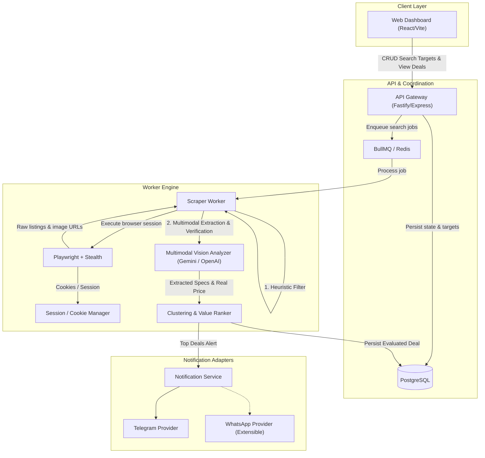

# Radar Price — Architecture Specification

High-performance, automated deal sniper and price intelligence system for Facebook Marketplace (with primary localization for Bolivia and LATAM markets).

---

## 1. System Overview

---

## 2. Core Pillars & Design Decisions

### 2.1 The Two-Tier Filter (Cost & Latency Optimization)
Passing every raw scraped listing to a multimodal vision LLM is expensive and slow.
- **Tier 1 (Heuristic Engine - In-memory / CPU)**:
  - Filter out posts with keywords indicating buyer intent (`busco`, `compro`, `se busca`).
  - Filter out explicit junk (`repuestos`, `para piezas`, `bloqueado`, `iclou`).
  - Filter out extreme price outliers outside target search bounds (e.g. `price > maxPrice`).
  - Discard ~75% of noise without API calls.
- **Tier 2 (Multimodal AI Vision & OCR)**:
  - Download post images (up to 4 key images: screenshots of DxDiag, Windows specs, laptop chassis, stickers).
  - Extract structured JSON: exact CPU model, RAM amount, discrete GPU model, physical condition (1-10), and real price written in photos or text description.

### 2.2 Clustering & Arbitrage Ranking
- **Deduplication**: Match listings by title/model similarity and perceptual image hashing (`pHash`) to avoid repeated alerts when sellers repost identical items.
- **Fair Market Price (FMP) Baseline**: Compare the item against historical medians for the same hardware tier (e.g. RTX 3060 + Ryzen 7).
- **Deal Score Formulation**:
  $$\text{DealScore} = \left(\frac{\text{FairMarketPrice} - \text{RealPrice}}{\text{FairMarketPrice}}\right) \times 100 \times \text{ConditionFactor}$$

### 2.3 Pluggable Notification Architecture (Adapter Pattern)
- Decouple deal detection from notification delivery.
- Interface: `NotificationProvider`:
  - `TelegramNotificationProvider`: Default zero-cost, rich media delivery (photo albums, markdown specs, direct links).
  - `WhatsAppNotificationProvider`: Plug-in provider ready for WhatsApp Cloud API or local gateways (Evolution API).

---

## 3. Data Model (Prisma)

- **SearchTarget**: Query keywords, min/max price, location/coordinates, interval, status.
- **Listing**: Raw scraped post (external Facebook ID, title, listed price, URLs, images).
- **Evaluation**: Extracted hardware specs, real price, condition rating, deal score, AI reasoning.
- **Alert**: History of sent notifications to avoid alert spam.
